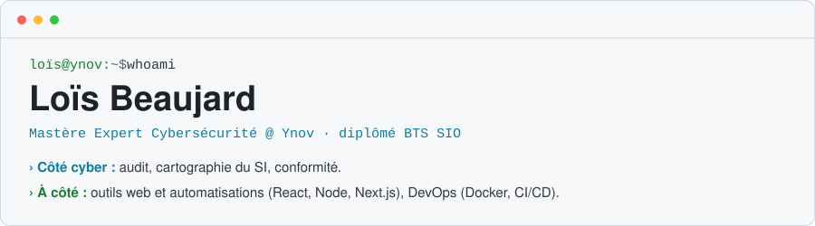
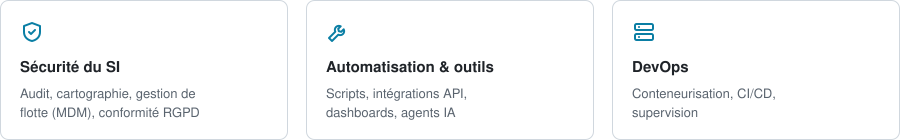

<picture>
  <source media="(prefers-color-scheme: dark)" srcset="assets/banniere-dark.svg">
  
</picture>

  
  
  
  

---

### Ce que je fais

<picture>
  <source media="(prefers-color-scheme: dark)" srcset="assets/ce-que-je-fais-dark.svg">
  
</picture>

### En ce moment

- Mastère 1 : gouvernance & conformité (CISO Assistant), projet MFA pour un cas bancaire
- Freelance : ouvert aux missions d'outillage et d'automatisation
- Je cherche un **stage ou une alternance en cybersécurité**

### Projets phares

| Projet | Description | Stack |
|---|---|---|
| [**Chez José**](https://chezjosecafe.com) client | Site d'un café-restaurant à Montréal en 3 langues : commande en ligne avec prix recalculés côté serveur, écran cuisine, éditeur de carte protégé par 2FA · [en ligne](https://chezjosecafe.com) | HTML/CSS/JS vanilla · Node serverless · Neon Postgres · Vercel |
| **Outil Audit** privé | Scanner d'audit de serveurs Linux/Windows (nmap, TLS, SMB) avec rapport HTML | Python |
| **Veille Info** privé | Veille tech Cyber/IA/Dev : agrégation RSS et scraping automatisé · [en ligne](https://veille-info-one.vercel.app) | Next.js · Neon Postgres · Vercel |
| **Yamikapiko** privé | App mobile de jeux de soirée : quiz, défis, modes duo/équipe, roulette (iOS & Android) | React Native · Expo |
| [**bde-site**](https://github.com/lois114/bde-site) | Site officiel du BDE Ynov Toulouse · [voir en ligne](https://ynov-toulouse-bde.vercel.app) | Next.js · TypeScript · Vercel |

### Autres projets

| Projet | Description | Stack |
|---|---|---|
| **Auto PME** privé | Prospection B2B automatisée : recherche d'entreprises et génération de contenu par IA | Node.js · Vercel · Neon |
| **Filao Dashboard** privé | Dashboard KPI d'entreprise connecté à Google Sheets | Next.js · Chart.js |
| **Muscu** privé | PWA de suivi de musculation, offline-first, avec analyse IA des séances | React · Vite · Tailwind |
| [**DOCKER_P**](https://github.com/lois114/DOCKER_P) | API conteneurisée avec CI/CD et supervision (Prometheus, Grafana) | Python · Docker · GitHub Actions |

### Technologies

**Systèmes & Sécurité**

**Langages**

**Web**

**Bases de données**

**DevOps & Outils**

### Stats

  
  

### Certifications

Google Cybersecurity · AWS Generative AI Applications · Google AI Essentials

---

Un projet, une mission ou une question : <a href="mailto:loisbeaujard@gmail.com">écris-moi</a>.

